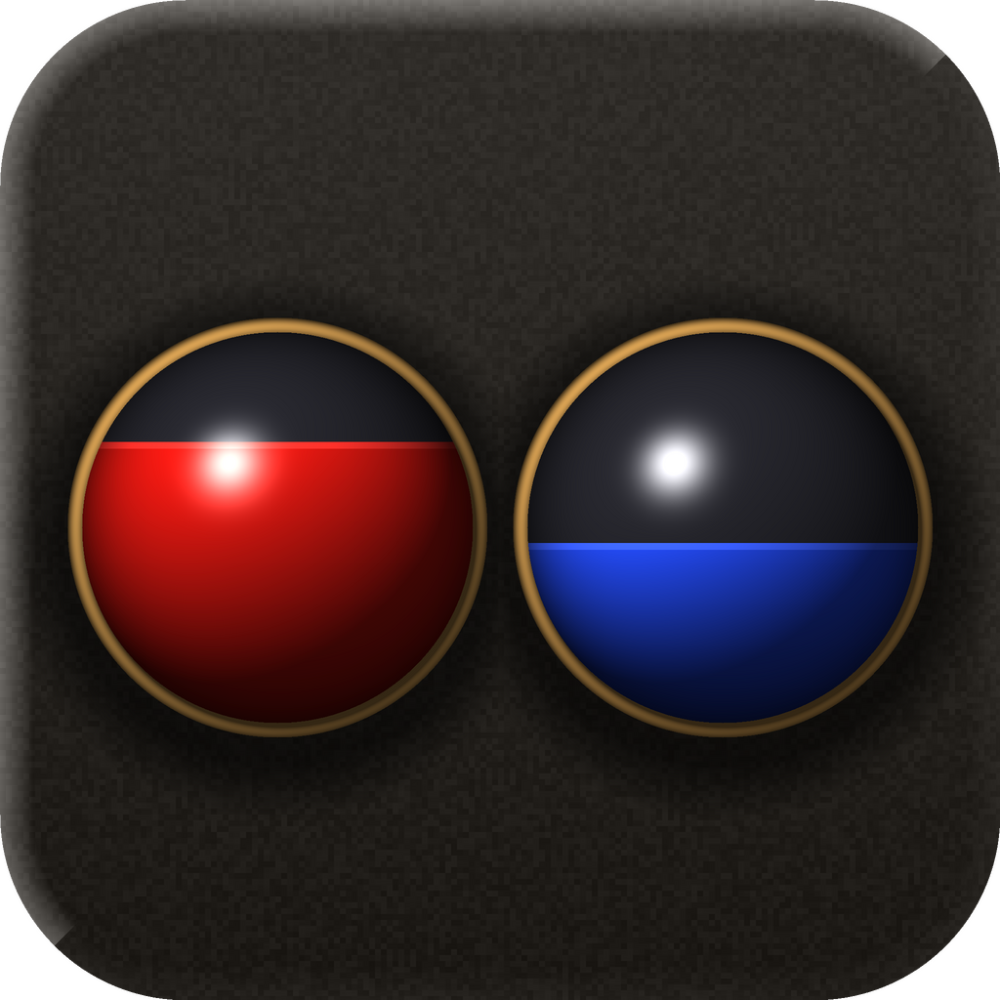
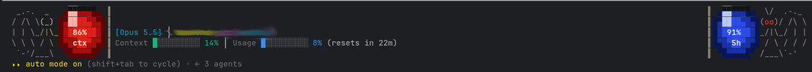

# diablo-orbs

A Diablo II-style status line for the Claude Code terminal, built as a Claude Code mod.



- **Red life orb (left, held by a stone angel):** context window left. It drains as the conversation fills the context and refills after compaction.
- **Blue mana orb (right, held by a stone demon):** rate limit left in the 5-hour window, or the 7-day window when that is the only reading. It shows as grey glass when there is no subscription rate-limit data.
- **Between them:** your existing status line output, from any `statusLine` command (for example claude-hud), with its ANSI colours kept.

## Install

At the prompt of a Claude Code terminal session:

```
/plugin install diablo-orbs --marketplace kadmi/claude-diablo-orbs
```

From a shell:

```bash
claude plugin install diablo-orbs --marketplace kadmi/claude-diablo-orbs
```

Answer `y` to add the marketplace, then pick the user scope. The mod loads in every terminal session after that.

## Layout by terminal size

- 100 columns or wider: orbs and statues.
- 48 to 99 columns: orbs only.
- Narrower than 48 columns, or fewer than 2 rows for the status line: a compact `♥ 72%  ✦ 40%` is added after your normal line.
- With 5 rows the liquid level moves in 10% steps. The number inside each orb moves in 1% steps.

There is nothing to configure.

## Disclaimer

This is a fan-made tribute and is not affiliated with or endorsed by Blizzard Entertainment. Diablo is a trademark of Blizzard Entertainment, Inc. All art here is original ASCII and block-character drawing.

## License

MIT
